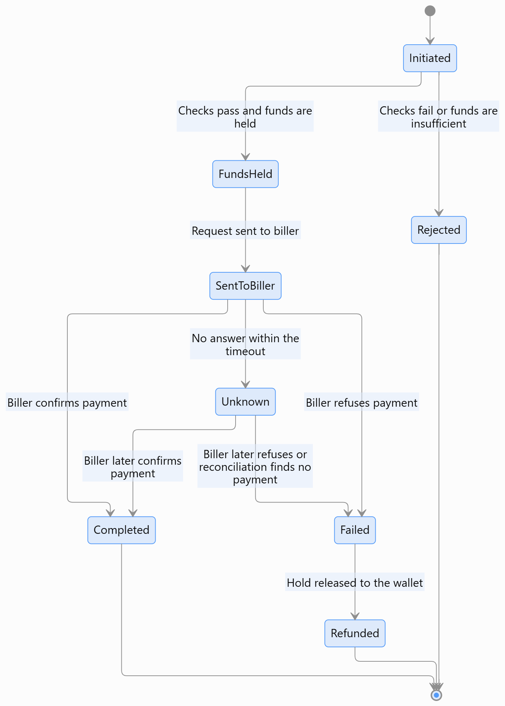
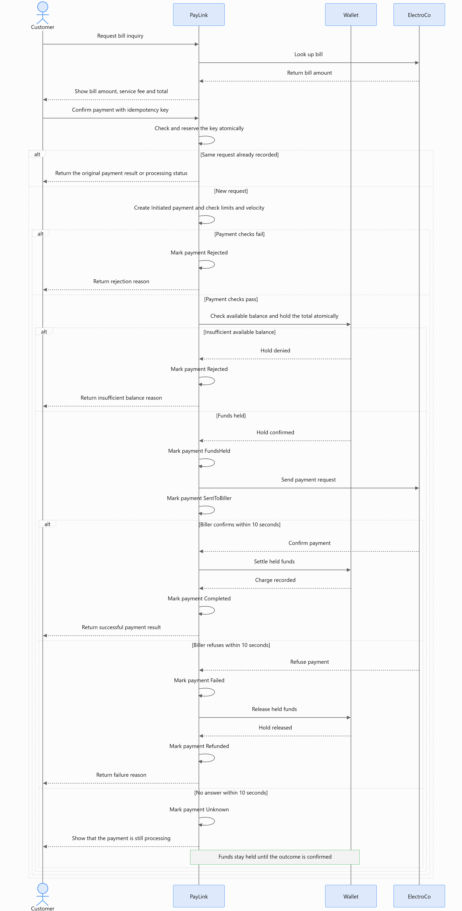

# Part 2 - Payment User Stories

## US-11: Inquire about a bill (FR-8, Must)

As a customer,
I want to look up my bill and see its amount, service fee and total,
so that I know how much I will pay before confirming the payment.

Acceptance criteria:

1. Given ElectroCo returns a bill amount of 350.00 EGP and the applicable service fee is 2.50 EGP,
   When I run a bill inquiry,
   Then I see the bill amount of 350.00 EGP, the fee of 2.50 EGP and the total of 352.50 EGP before confirming payment.

## US-12: Pay a bill from the wallet (FR-9, Must)

As a customer,
I want to pay a bill using my wallet,
so that I can settle it using my available balance.

Acceptance criteria:

1. Given the wallet has enough available funds and the payment passes the required checks,
   When I confirm payment and the biller confirms success,
   Then the held funds are charged and I receive a successful payment result.

2. Given the available balance is less than the payment total,
   When I try to pay,
   Then the payment is Rejected, no funds are held and the biller is not called.

3. Given two otherwise valid payment requests arrive at the same time and the wallet can cover only one,
   When both try to hold funds,
   Then only one obtains a hold, the other is Rejected and the available balance never becomes negative.

## US-13: Prevent duplicate charges (FR-10, Must)

As a customer,
I want to safely resend a payment request if the connection drops,
so that the same payment is charged only once.

Acceptance criteria:

1. Given a payment result has already been recorded,
   When I resend the same request with the same idempotency key,
   Then I receive the original result and neither a second payment nor a second charge is created.

2. Given two copies of the same valid payment request arrive at the same time with the same idempotency key, and the wallet has sufficient available funds,
   When PayLink processes both copies,
   Then only one payment is created, only one hold is placed and only one payment request is sent to the biller.

## US-14: Track the payment lifecycle (FR-11, Must)

As a customer,
I want the payment status to reflect what happened to my payment,
so that I know whether it completed or is still being processed.

Acceptance criteria:

1. Given a payment is SentToBiller,
   When the biller confirms success,
   Then the payment moves to Completed.

2. Given a payment is SentToBiller and a live biller has not answered within 10 seconds,
   When the request times out,
   Then the payment moves to Unknown and I am told it is still being processed.

3. Given a payment is Unknown,
   When the biller later confirms the payment,
   Then the payment moves to Completed.

4. Given a payment is Unknown,
   When the biller later refuses it or reconciliation finds no payment,
   Then the payment moves to Failed.

5. Given a payment is in any lifecycle state,
   When an event would cause a transition outside section 2.5 of the brief,
   Then the state does not change. Completed, Rejected and Refunded are final.

## US-15: Hold and release wallet funds (FR-12, Must)

As a customer,
I want PayLink to hold funds during payment processing and release them after a confirmed failure,
so that I can use the money again if the bill was not paid.

Acceptance criteria:

1. Given the payment passes the required checks and the wallet has sufficient available funds,
   When PayLink prepares to send the payment,
   Then it holds the payment total before calling the biller and the held amount is unavailable for another payment.

2. Given the payment has an active hold,
   When PayLink confirms that the payment failed,
   Then the hold is released to the wallet and the payment moves from Failed to Refunded after the release.

3. Given the payment is Unknown,
   When the biller's result is still unconfirmed,
   Then the money remains held.

## US-16: Enforce payment limits (FR-18, Must)

As a customer,
I want to know when a payment exceeds my limits,
so that I understand why the payment was rejected.

Acceptance criteria:

1. Given the configured single-payment range is 5.00 to 10,000.00 EGP,
   When the payment amount is below 5.00 EGP or above 10,000.00 EGP,
   Then the request is rejected with a clear reason before any funds are held.

2. Given a Basic account has already used 4,900.00 EGP of its 5,000.00 EGP daily allowance,
   When the customer requests a payment that would add 200.00 EGP to the daily usage,
   Then the payment is rejected with a daily-limit reason before any funds are held.

3. Given a Verified account has already used 29,900.00 EGP of its 30,000.00 EGP daily allowance,
   When the customer requests a payment that would add 200.00 EGP to the daily usage,
   Then the payment is rejected with a daily-limit reason before any funds are held.

## US-17: Limit rapid payment activity (FR-19, Should)

As a customer,
I want rapid payment activity on my account to trigger a temporary payment block,
so that the account cannot keep submitting payments at that rate.

Acceptance criteria:

1. Given five qualifying payments from the same account already count within the preceding 60 seconds,
   When a sixth qualifying payment is submitted within that window,
   Then it is blocked and the account cannot submit payments for 10 minutes.

2. Given the temporary payment block is active,
   When the account tries to make another payment,
   Then the request is rejected before funds are held or the biller is called.

3. Given the temporary payment block has expired,
   When the account submits a new payment,
   Then PayLink applies the normal payment checks.

## Open Questions and Proposed Decisions

| Question | Proposed decision | Status |
| --- | --- | --- |
| Do the payment limits include the service fee? Do payments with active holds count toward daily usage? | Use the bill amount for limit checks. Count completed payments and payments with active holds toward daily usage. Remove a failed payment from the count when its hold is released. | Pending team confirmation |
| Which requests count toward the five-payment rule in FR-19? | Count each distinct payment submission once, including rejected submissions. A retransmission with the same key and the same request does not count again. | Pending team confirmation |
| What happens if a customer reuses an idempotency key with a different amount or service? | Reject the request as a key conflict and leave the original payment untouched. | Pending team confirmation |
| Do payments made earlier in the day count after upgrading to Verified? | Keep the amount already counted that day and apply the new Verified limit, consistent with the assumption in Part 1. | Pending team confirmation |

## Integration with Part 1

- The `payments` table uses `wallet_id` and `service_id`.
- Payment-related `ledger_entries` reference the payment through `reference_type` and `reference_id`.
## Payment Diagrams

### Payment State Diagram

### Pay a Bill Sequence Diagram

