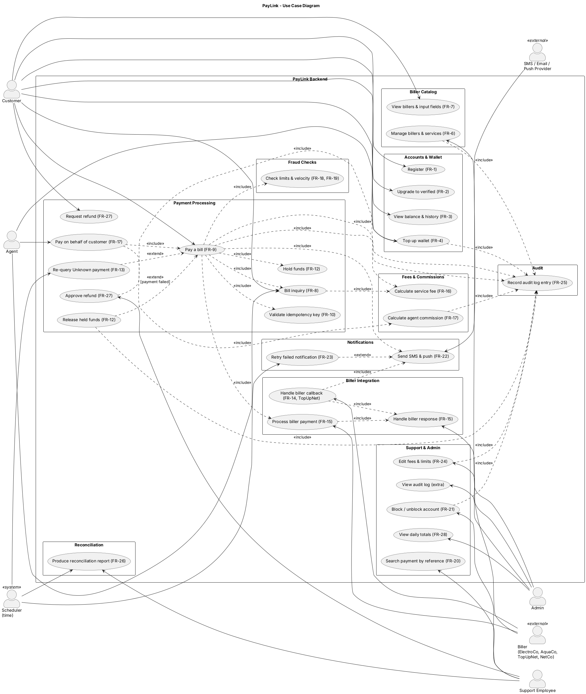
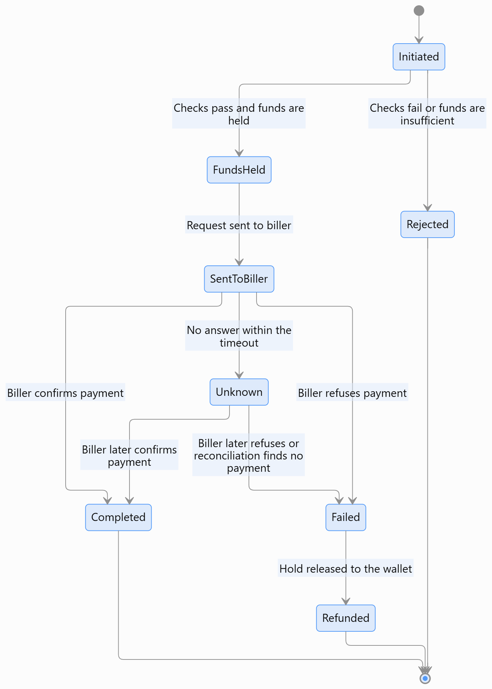
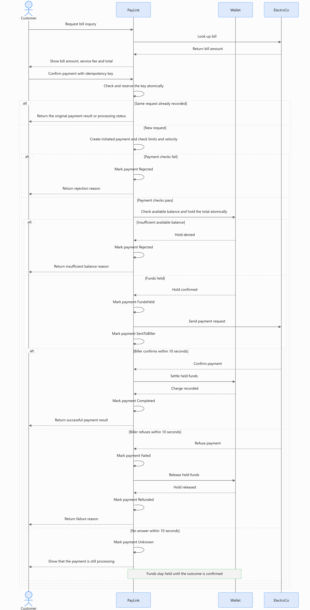

# PayLink - Requirements Pack (Phase 1)

## 1. Problem summary

PayLink is a bill-payment and wallet backend for a company in Egypt, similar to Fawry. Customers pay utility bills (electricity, water, mobile top-up and internet) from a digital wallet, either in the app or through agents. PayLink holds customers' money, so it must be correct: no customer may be charged twice, and no balance may become negative. A payment can fail at many steps (fraud checks, the biller not answering, a late callback), so the system must handle each failure safely. Our team builds the backend, with a design that makes adding new billers easy and that records every money movement in a ledger.

## 2. Stakeholders

| Stakeholder                          | What they need from the system                                        |
| ------------------------------------ | --------------------------------------------------------------------- |
| Customer                             | Pay bills quickly and safely from the wallet; see balance and history |
| Agent                                | Pay on behalf of customers and earn commission                        |
| Biller (ElectroCo, AquaCo, TopUpNet) | Receive correct payments and a matching settlement                    |
| PayLink admin                        | Manage billers, fees and limits without redeploying                   |
| Support employee                     | Find a payment, see its history, block or unblock accounts            |
| PayLink management and finance       | Earn fees, avoid losses, get daily totals                             |
| Regulators                           | Safe handling of customers' money and an audit trail                  |

## 3. Priorities

Every story has a priority taken from the brief: **Must** (required), **Should** (important, but the system works without it) and **Could** (nice to have).

## 4. User stories

The pack has 54 stories: 10 (Part 1) + 7 (Part 2) + 20 (Part 3) + 13 (Part 4) + 4 added during the merge.

### 4.1 Part 1 - Accounts, wallet, billers and fees

#### US-1: Register a customer (FR-1, Must)

As a new customer,
I want to register an account,
so that I can have a wallet and pay my bills.

Acceptance criteria:

1. Given a phone number that is not registered,
   When I submit a valid name, phone number and password,
   Then an account is created with verification level "basic" and a wallet with available balance 0.00 EGP and held balance 0.00 EGP.

2. Given a phone number that is already registered,
   When I try to register again with the same phone number,
   Then the registration is rejected with a clear error message and no second account is created.

3. Given I leave the name, phone number or password empty,
   When I submit the registration,
   Then the request is rejected and the error message names the missing field.

#### US-2: Upgrade a customer to verified (FR-2, Should)

As a basic customer,
I want to be upgraded to the verified level,
so that I can pay larger amounts per day.

Acceptance criteria:

1. Given a customer with level "basic" and a daily limit of 5,000 EGP,
   When the customer is upgraded to "verified",
   Then the level is "verified" and the daily limit is 30,000 EGP.

2. Given a basic customer who already paid 4,000 EGP today,
   When the customer is upgraded to "verified",
   Then the remaining daily allowance is 26,000 EGP.

#### US-3: View wallet balance and transaction history (FR-3, Must)

As a customer,
I want to see my available balance, my held balance and my transaction history,
so that I know how much I can spend and where my money went.

Acceptance criteria:

1. Given a wallet with 650.00 EGP available and 352.50 EGP held,
   When I open my wallet,
   Then I see "available: 650.00 EGP" and "held: 352.50 EGP" as two separate values.

2. Given I made a top-up of 500.00 EGP and then a payment of 352.50 EGP,
   When I open my transaction history,
   Then I see both transactions, each with date, type and amount, ordered by date.

3. Given another customer has transactions,
   When I open my transaction history,
   Then I see only my own transactions.

#### US-4: Top up the wallet (FR-4, Must)

As a customer,
I want to top up my wallet by simulated card or agent cash,
so that I have money available to pay bills.

Acceptance criteria:

1. Given a wallet with 100.00 EGP available,
   When I top up 500.00 EGP by simulated card,
   Then the available balance becomes 600.00 EGP.

2. Given a wallet with 100.00 EGP available,
   When an agent tops up 200.00 EGP in cash for me,
   Then the available balance becomes 300.00 EGP.

3. Given a wallet with 100.00 EGP available,
   When I try to top up 0 EGP or a negative amount,
   Then the request is rejected and the balance stays 100.00 EGP.

#### US-5: Record every balance change in a ledger (FR-5, Must)

As PayLink (the company),
I want every balance change to create a ledger entry and every balance to be computed from the ledger,
so that all money movements are traceable and balances can never be silently changed.

Acceptance criteria:

1. Given a wallet,
   When a top-up of 500.00 EGP completes,
   Then exactly one new ledger entry is created with wallet, amount, type and timestamp.

2. Given a ledger with a credit of 1,000.00 EGP and a hold of 352.50 EGP,
   When the balance is calculated,
   Then available is 647.50 EGP and held is 352.50 EGP, both computed from the ledger entries.

3. Given any operation that changes a balance (top-up, hold, release, charge, refund),
   When the operation completes,
   Then a ledger entry exists for it, and no balance value was changed without a ledger entry.

#### US-6: Manage billers and services (FR-6, Must)

As an admin,
I want to add, edit and disable billers and services,
so that the catalog stays correct without changing the system.

Acceptance criteria:

1. Given I am an admin,
   When I add the biller "ElectroCo" with service "Electricity" and the required field "meter number",
   Then the biller appears in the biller catalog.

2. Given an existing service with a maximum amount of 10,000 EGP,
   When I edit the maximum amount to 8,000 EGP,
   Then the catalog shows 8,000 EGP as the maximum for that service.

3. Given an active biller,
   When I disable it,
   Then it no longer appears in the list shown to customers.

#### US-7: See the list of billers and required fields (FR-7, Must)

As a customer,
I want to see the available billers and the input fields each one requires,
so that I know what information I must enter before paying.

Acceptance criteria:

1. Given active billers ElectroCo, AquaCo and TopUpNet,
   When I open the biller list,
   Then I see all three, each with its services.

2. Given the biller ElectroCo requires a meter number,
   When I open its details,
   Then I see "meter number" as a required field.

3. Given a biller is disabled,
   When I open the biller list,
   Then that biller is not shown.

#### US-8: Fixed and percentage fees (FR-16, Must)

As a customer,
I want to see the service fee and the total before I pay,
so that I know exactly what will be taken from my wallet.

Acceptance criteria:

1. Given an electricity bill of 350.00 EGP,
   When the fee is calculated,
   Then the fee is 2.50 EGP and the total is 352.50 EGP.

2. Given a water bill of 120.00 EGP,
   When the fee is calculated,
   Then the fee is 2.50 EGP and the total is 122.50 EGP.

3. Given a mobile top-up of 200.00 EGP,
   When the fee is calculated,
   Then the fee is 3.00 EGP (1.5%).

4. Given a mobile top-up of 50.00 EGP,
   When the fee is calculated,
   Then the fee is 1.00 EGP (the minimum, because 1.5% is 0.75 EGP).

#### US-9: Tiered fee for internet bills (FR-16, Must)

As a customer,
I want the internet fee to follow the tier of my bill amount,
so that the fee I pay is the correct one.

Acceptance criteria:

1. Given an internet bill of 150.00 EGP,
   When the fee is calculated,
   Then the fee is 2.00 EGP.

2. Given an internet bill of exactly 200.00 EGP,
   When the fee is calculated,
   Then the fee is 2.00 EGP.

3. Given an internet bill of 200.01 EGP,
   When the fee is calculated,
   Then the fee is 4.00 EGP.

#### US-10: Promotion period with zero fee (FR-16, Must)

As PayLink (the company),
I want to run a promotion where the fee is 0 for one chosen biller between two configured dates,
so that we can attract customers to that biller.

Acceptance criteria:

1. Given a promotion for ElectroCo from 1 December to 7 December,
   When a customer pays a 350.00 EGP electricity bill on 3 December,
   Then the fee is 0.00 EGP and the total is 350.00 EGP.

2. Given the same promotion,
   When a customer pays an electricity bill on 8 December,
   Then the normal fee of 2.50 EGP applies.

3. Given the same promotion for ElectroCo,
   When a customer pays a water bill to AquaCo on 3 December,
   Then the normal fee of 2.50 EGP applies.

### 4.2 Part 2 - Payment processing and fraud checks

#### US-11: Inquire about a bill (FR-8, Must)

As a customer,
I want to look up my bill and see its amount, service fee and total,
so that I know how much I will pay before confirming the payment.

Acceptance criteria:

1. Given ElectroCo returns a bill amount of 350.00 EGP and the applicable service fee is 2.50 EGP,
   When I run a bill inquiry,
   Then I see the bill amount of 350.00 EGP, the fee of 2.50 EGP and the total of 352.50 EGP before confirming payment.

#### US-12: Pay a bill from the wallet (FR-9, Must)

As a customer,
I want to pay a bill using my wallet,
so that I can settle it using my available balance.

Acceptance criteria:

1. Given the wallet has enough available funds and the payment passes the required checks,
   When I confirm payment and the biller confirms success,
   Then the held funds are charged and I receive a successful payment result.

2. Given the available balance is less than the payment total,
   When I try to pay,
   Then the payment is Rejected, no funds are held and the biller is not called.

3. Given two otherwise valid payment requests arrive at the same time and the wallet can cover only one,
   When both try to hold funds,
   Then only one obtains a hold, the other is Rejected and the available balance never becomes negative.

#### US-13: Prevent duplicate charges (FR-10, Must)

As a customer,
I want to safely resend a payment request if the connection drops,
so that the same payment is charged only once.

Acceptance criteria:

1. Given a payment result has already been recorded,
   When I resend the same request with the same idempotency key,
   Then I receive the original result and neither a second payment nor a second charge is created.

2. Given two copies of the same valid payment request arrive at the same time with the same idempotency key, and the wallet has sufficient available funds,
   When PayLink processes both copies,
   Then only one payment is created, only one hold is placed and only one payment request is sent to the biller.

#### US-14: Track the payment lifecycle (FR-11, Must)

As a customer,
I want the payment status to reflect what happened to my payment,
so that I know whether it completed or is still being processed.

Acceptance criteria:

1. Given a payment is SentToBiller,
   When the biller confirms success,
   Then the payment moves to Completed.

2. Given a payment is SentToBiller and a live biller has not answered within 10 seconds,
   When the request times out,
   Then the payment moves to Unknown and I am told it is still being processed.

3. Given a payment is Unknown,
   When the biller later confirms the payment,
   Then the payment moves to Completed.

4. Given a payment is Unknown,
   When the biller later refuses it or reconciliation finds no payment,
   Then the payment moves to Failed.

5. Given a payment is in any lifecycle state,
   When an event would cause a transition outside section 2.5 of the brief,
   Then the state does not change. Completed, Rejected and Refunded are final.

#### US-15: Hold and release wallet funds (FR-12, Must)

As a customer,
I want PayLink to hold funds during payment processing and release them after a confirmed failure,
so that I can use the money again if the bill was not paid.

Acceptance criteria:

1. Given the payment passes the required checks and the wallet has sufficient available funds,
   When PayLink prepares to send the payment,
   Then it holds the payment total before calling the biller and the held amount is unavailable for another payment.

2. Given the payment has an active hold,
   When PayLink confirms that the payment failed,
   Then the hold is released to the wallet and the payment moves from Failed to Refunded after the release.

3. Given the payment is Unknown,
   When the biller's result is still unconfirmed,
   Then the money remains held.

#### US-16: Enforce payment limits (FR-18, Must)

As a customer,
I want to know when a payment exceeds my limits,
so that I understand why the payment was rejected.

Acceptance criteria:

1. Given the configured single-payment range is 5.00 to 10,000.00 EGP,
   When the payment amount is below 5.00 EGP or above 10,000.00 EGP,
   Then the request is rejected with a clear reason before any funds are held.

2. Given a Basic account has already used 4,900.00 EGP of its 5,000.00 EGP daily allowance,
   When the customer requests a payment that would add 200.00 EGP to the daily usage,
   Then the payment is rejected with a daily-limit reason before any funds are held.

3. Given a Verified account has already used 29,900.00 EGP of its 30,000.00 EGP daily allowance,
   When the customer requests a payment that would add 200.00 EGP to the daily usage,
   Then the payment is rejected with a daily-limit reason before any funds are held.

#### US-17: Limit rapid payment activity (FR-19, Should)

As a customer,
I want rapid payment activity on my account to trigger a temporary payment block,
so that the account cannot keep submitting payments at that rate.

Acceptance criteria:

1. Given five qualifying payments from the same account already count within the preceding 60 seconds,
   When a sixth qualifying payment is submitted within that window,
   Then it is blocked and the account cannot submit payments for 10 minutes.

2. Given the temporary payment block is active,
   When the account tries to make another payment,
   Then the request is rejected before funds are held or the biller is called.

3. Given the temporary payment block has expired,
   When the account submits a new payment,
   Then PayLink applies the normal payment checks.

### 4.3 Part 3 - Biller integration and reconciliation

#### Biller Integration

| ID | Story | Acceptance criteria (Given / When / Then) | Priority |
|---|---|---|---|
| US-BI-1 | As the system, I send a payment to ElectroCo through its adapter. | **Given** funds are held, **when** the adapter calls ElectroCo with a unique reference, **then** a "paid" answer is returned to Payment Processing as a confirmation. | Must |
| US-BI-2 | As a customer, I can run a bill inquiry for any biller. | **Given** a valid meter or phone number, **when** I request an inquiry, **then** the adapter returns the amount due in one common internal format, whatever the biller's protocol. | Must |
| US-BI-3 | As the system, I talk to AquaCo in its XML format and map its error codes. | **Given** AquaCo answers with an error code, **when** the adapter parses it, **then** it returns a refusal with a clear internal reason code. | Must |
| US-BI-4 | As the system, I map AquaCo's rejection of an amount above the bill. | **Given** AquaCo rejects a payment above the bill amount, **when** the adapter receives the rejection, **then** it returns a refusal with reason "amount exceeds bill" and the payment becomes Failed. | Should |
| US-BI-5 | As the system, I treat a slow biller as Unknown. | **Given** a live biller does not answer within 10 s (configurable), **when** the timeout fires, **then** the adapter reports "no answer", the payment becomes Unknown and the money stays held. | Must |
| US-BI-6 | As the system, I re-query Unknown payments. | **Given** a payment is Unknown, **when** 1, 5 and 15 minutes have passed, **then** the adapter re-queries the biller; a definite answer moves the payment to Completed or Failed; after the third attempt it waits for reconciliation. | Must |
| US-BI-7 | As the system, I accept TopUpNet's asynchronous callback. | **Given** TopUpNet replied "accepted", **when** it calls the callback URL with success or failed, **then** the result is passed to Payment Processing. | Must |
| US-BI-8 | As the system, I ignore duplicate callbacks. | **Given** a payment is already Completed, **when** a second "success" callback arrives, **then** the state is unchanged and the duplicate is logged. | Must |
| US-BI-9 | As the system, I verify that callbacks come from TopUpNet. | **Given** a callback without a valid secret or signature, **when** it arrives, **then** it is rejected with 401 and logged. | Should |
| US-BI-10 | As a developer, I can add a new biller without touching other modules. | **Given** a new adapter and its configuration, **when** the application starts, **then** the biller works and no file outside Biller Integration and configuration changed. | Must |
| US-BI-11 | As the system, a biller outage does not stop payments to other billers. | **Given** ElectroCo is down, **when** a customer pays AquaCo, **then** the payment completes normally. | Must |
| US-BI-12 | As the system, I absorb ElectroCo API v2 (new field names, piasters, signed requests). | **Given** v2 is enabled by configuration, **when** a payment is sent, **then** the amount is converted to piasters, the request is signed, and only the ElectroCo adapter changed. | Should |
| US-BI-13 | As the system, I exchange NetCo's daily batch files. | **Given** payments for NetCo during the day, **when** the daily job runs, **then** one CSV is uploaded and the next morning's result file updates the payment states. | Could |

#### Reconciliation

| ID | Story | Acceptance criteria (Given / When / Then) | Priority |
|---|---|---|---|
| US-RC-1 | As support, I want the system to import a biller's settlement file. | **Given** a valid settlement file, **when** it is uploaded or found in the configured folder, **then** every row is parsed and stored. | Should |
| US-RC-2 | As support, I want a daily reconciliation report. | **Given** a settlement file, **when** the nightly job runs, **then** PayLink's payments for that biller and day are compared with it and a report is produced. | Should |
| US-RC-3 | As support, I want differences flagged. | **Given** the file lists a payment PayLink has as Failed, **when** reconciliation runs, **then** the difference appears in the report for support to review. | Must |
| US-RC-4 | As the system, I resolve Unknown payments from the settlement file. | **Given** a payment is Unknown, **when** the file lists it, **then** it becomes Completed; **when** the file does not list it, **then** it becomes Failed. | Must |
| US-RC-5 | As support, I want amount differences flagged. | **Given** the same reference has different amounts on both sides, **when** reconciliation runs, **then** it is reported as an amount difference. | Should |
| US-RC-6 | As support, I want references unknown to PayLink flagged. | **Given** the file contains a reference PayLink has no record of, **when** reconciliation runs, **then** it is reported as "unknown to PayLink". | Should |
| US-RC-7 | As an auditor, I want reconciliation actions logged. | **Given** reconciliation changes a payment's state, **when** the change is saved, **then** an audit record with who, when and why is written. | Must |

Total: 13 + 7 = 20 stories.

### 4.4 Part 4 - Notifications, support and admin

#### FR-20 - Support payment search (Must)

**US-20-a: Search a payment by reference** - *Must*
As a support employee, I want to search for a payment by its reference so that I can answer a customer's complaint quickly.

- **Given** a payment with reference `PL-1001` exists, **when** I search for `PL-1001`, **then** the system returns that payment with its amount, fee, biller, customer and current state.
- **Given** no payment has reference `PL-9999`, **when** I search for it, **then** the system returns "not found" and no other payment's data.
- **Given** I am logged in as a customer (not support), **when** I call the search endpoint, **then** the request is rejected with 403.

**US-20-b: See the full history of a payment** - *Must*
As a support employee, I want to see every state change of a payment so that I can explain to the customer what happened.

- **Given** payment `PL-1002` went Initiated -> FundsHeld -> SentToBiller -> Unknown -> Completed, **when** I open it, **then** I see all 5 states in order with the time of each change.
- **Given** the payment has money movements (hold, charge, fee, commission), **when** I open it, **then** I see the related ledger entries.
- **Given** the payment has notifications, **when** I open it, **then** I see each message and its delivery status (sent / undelivered).

#### FR-21 - Block and unblock accounts (Should)

**US-21-a: Block an account** - *Should*
As a support employee, I want to block an account so that a suspected fraudster cannot pay.

- **Given** an active account, **when** I block it with a reason, **then** its status becomes Blocked.
- **Given** a Blocked account, **when** its owner starts a payment, **then** the payment is Rejected with the reason "account blocked" and no money is held.
- **Given** I block an account, **when** the action completes, **then** an audit record is written with my user, the time and the reason.

**US-21-b: Unblock an account** - *Should*
As a support employee, I want to unblock an account so that a wrongly blocked customer can pay again.

- **Given** a Blocked account, **when** I unblock it, **then** its status becomes Active and the next valid payment is accepted.
- **Given** the account was blocked automatically by the velocity rule (FR-19), **when** I unblock it before the 10 minutes end, **then** it becomes Active immediately.
- **Given** I unblock an account, **when** the action completes, **then** an audit record is written.

#### FR-22 - Payment notifications (Must)

**US-22-a: Notification on completion** - *Must*
As a customer, I want an SMS and a push message when my payment completes so that I have proof of payment.

- **Given** a payment moves to Completed, **when** the state change is saved, **then** one SMS and one push message are created containing the amount, biller, fee and reference.
- **Given** the payment completed after being Unknown (late callback or settlement), **when** it becomes Completed, **then** the customer still gets the message, once.

**US-22-b: Notification on failure** - *Must*
As a customer, I want a clear message when my payment fails so that I know my money is safe and what to do.

- **Given** AquaCo refuses a payment with an error code, **when** the payment becomes Failed, **then** the customer gets an SMS with a clear reason (not the raw error code).
- **Given** the payment is Rejected by a fraud rule, **when** it is rejected, **then** the customer is told the reason (limit exceeded, too many payments, blocked).
- **Given** the notification provider is down, **when** a payment completes or fails, **then** the payment result is not affected (see US-23-a).

#### FR-23 - Notification retry (Should)

**US-23-a: Retry failed messages** - *Should*
As the company, I want failed SMS and email to be retried so that temporary provider problems do not lose messages.

- **Given** the SMS provider returns an error, **when** the first attempt fails, **then** the system retries up to 3 more times (retry count and delay come from configuration).
- **Given** a retry succeeds, **when** the provider accepts the message, **then** the status becomes Sent and no more retries happen.
- **Given** the payment is Completed, **when** all notification attempts fail, **then** the payment stays Completed.

**US-23-b: Mark undelivered** - *Should*
As a support employee, I want messages that never arrived to be marked undelivered so that I can contact the customer another way.

- **Given** the 3 retries all failed, **when** the last one fails, **then** the message status becomes Undelivered and no further attempt is made.
- **Given** an Undelivered message, **when** I view the payment (US-20-b), **then** I see the status and the last error.

#### FR-24 - Editable fees and limits (Should)

**US-24-a: Edit fee values** - *Should*
As an admin, I want to change fee values without redeploying so that business can react quickly.

- **Given** the electricity fee is 2.50 EGP, **when** I change it to 3.00 EGP, **then** new payments use 3.00 and payments already created keep their original fee.
- **Given** I enter a negative or non-numeric fee, **when** I save, **then** the change is rejected with a validation message.
- **Given** I set a promotion with start and end dates for one biller, **when** a payment happens inside the period, **then** its fee is 0.

**US-24-b: Edit limits** - *Should*
As an admin, I want to change daily and single-payment limits so that limits follow company policy.

- **Given** the basic daily limit is 5,000 EGP, **when** I change it to 4,000 EGP, **then** the next fraud check uses 4,000.
- **Given** minimum is greater than maximum, **when** I save, **then** the change is rejected.
- **Given** any fee or limit change, **when** it is saved, **then** an audit record stores the old value, new value, admin and time.

#### FR-25 - Audit log (Must)

**US-25-a: Audit every money movement** - *Must*
As an auditor, I want every money movement recorded with who, when and why so that we can prove the books are correct.

- **Given** any ledger entry is created (hold, release, charge, fee, commission, top-up, refund), **when** it is saved, **then** an audit record exists with actor, time, reason and payment reference.
- **Given** the audit write fails, **when** the money movement is being saved, **then** the whole movement is rolled back (no movement without an audit record).
- **Given** an audit record exists, **when** anyone tries to edit or delete it, **then** the system refuses (append only).

**US-25-b: Audit admin and support actions** - *Must*
As an auditor, I want admin and support actions recorded so that nobody can change settings silently.

- **Given** an admin edits a biller, fee or limit, or support blocks/unblocks an account, **when** the action succeeds, **then** an audit record stores who, what, old and new values, and time.
- **Given** I search the audit log by user or date range, **when** records match, **then** they are returned in time order.

#### FR-28 - Daily totals (Could)

**US-28-a: View daily totals** - *Could*
As an admin, I want daily totals so that I can follow the business.

- **Given** completed payments exist today, **when** I open the daily report, **then** I see the number and sum of payments, fees earned and commissions paid.
- **Given** some payments failed, **when** I open the report, **then** I see failures per biller.
- **Given** I choose another date, **when** I request it, **then** the totals match the ledger for that date (same numbers as the ledger sum).
- **Given** no payments on that date, **when** I request it, **then** all totals are 0, not an error.

### 4.5 Stories added during the merge (FR-17 and FR-27)

#### US-AG-1: Pay a bill on behalf of a customer (FR-17, Should)

As an agent,
I want to pay a customer's bill from my terminal,
so that customers who do not use the app can still pay.

Acceptance criteria:

1. Given I am logged in as an agent and the customer's wallet has enough available funds,
   When I submit a payment for the customer's bill,
   Then the payment follows the normal life cycle and the total is held from the customer's wallet.

2. Given an agent payment that is Completed,
   When I open its history,
   Then the payment shows which agent made it.

#### US-AG-2: Earn commission (FR-17, Should)

As an agent,
I want to receive a commission for each completed payment I make,
so that I am paid for my work.

Acceptance criteria:

1. Given an agent payment with a service fee of 2.50 EGP,
   When the payment becomes Completed,
   Then 1.00 EGP (40% of the fee) is credited to the agent's wallet as a COMMISSION ledger entry.

2. Given an agent payment that becomes Failed or Refunded,
   When the outcome is final,
   Then no commission is credited.

3. Given a payment made by the customer without an agent,
   When it becomes Completed,
   Then no commission is credited.

#### US-RF-1: Request a refund of a completed payment (FR-27, Could)

As a customer,
I want to ask for a refund of a completed payment,
so that I can get my money back when a payment was a mistake.

Acceptance criteria:

1. Given a Completed payment,
   When I request a refund and give a reason,
   Then a refund request with status "pending" is created and the payment state does not change.

2. Given a payment that is not Completed (for example Unknown or Failed),
   When I request a refund,
   Then the request is rejected, because those payments are handled by the retry and refund rules.

3. Given a refund request already exists for a payment,
   When I request a refund again,
   Then the second request is rejected.

#### US-RF-2: Approve or reject a refund request (FR-27, Could)

As a support employee,
I want to approve or reject refund requests,
so that refunds are only paid after a check.

Acceptance criteria:

1. Given a pending refund request,
   When I approve it,
   Then the payment total is credited to the customer's wallet as a REFUND ledger entry, an audit record is written, and the customer is notified.

2. Given a pending refund request,
   When I reject it with a reason,
   Then no money moves, the request becomes "rejected" and the customer is notified.

3. Given a request that is already approved or rejected,
   When I try to decide it again,
   Then the system refuses and nothing changes.

Draft: these four stories close the gaps found while merging (FR-17 and FR-27 were assigned to Part 3 but had no story). They are to be confirmed by their owner.

## 5. Non-functional requirements

| ID | Quality | Measurable target | How we measure |
|---|---|---|---|
| NFR-BI-1 | Resilience | With ElectroCo down, payments to AquaCo and TopUpNet still complete (success rate unchanged) | Integration test, mock set to fail |
| NFR-BI-2 | Modifiability | Adding a biller changes 0 files outside Biller Integration and configuration | Diff of the pull request |
| NFR-BI-3 | Timeout | Live biller calls time out at 10 s ± 0.5 s, value read from configuration | Test with a 12 s mock |
| NFR-BI-4 | Idempotency | 100% of duplicate callbacks cause 0 extra state changes | Duplicate-callback test |
| NFR-RC-1 | Auditability | 100% of reconciliation state changes have an audit record | Test over all reconciliation paths |
| NFR-RC-2 | Performance | A settlement file of 100,000 rows is reconciled in under 60 s | Benchmark in CI report |

## 6. Traceability: functional requirements to stories

Every FR of the brief (FR-1 to FR-28) has at least one story.

| FR | User stories | Priority |
|---|---|---|
| FR-1 | US-1 | Must |
| FR-2 | US-2 | Should |
| FR-3 | US-3 | Must |
| FR-4 | US-4 | Must |
| FR-5 | US-5 | Must |
| FR-6 | US-6 | Must |
| FR-7 | US-7 | Must |
| FR-8 | US-11, US-BI-2 | Must |
| FR-9 | US-12 | Must |
| FR-10 | US-13 | Must |
| FR-11 | US-14 | Must |
| FR-12 | US-15 | Must |
| FR-13 | US-BI-5, US-BI-6 | Must |
| FR-14 | US-BI-7, US-BI-8, US-BI-9 | Must |
| FR-15 | US-BI-1, US-BI-3, US-BI-4, US-BI-10, US-BI-11, US-BI-13 | Must |
| FR-16 | US-8, US-9, US-10 | Must |
| FR-17 | US-AG-1, US-AG-2 (added in merge) | Should |
| FR-18 | US-16 | Must |
| FR-19 | US-17 | Should |
| FR-20 | US-20-a, US-20-b | Must |
| FR-21 | US-21-a, US-21-b | Should |
| FR-22 | US-22-a, US-22-b | Must |
| FR-23 | US-23-a, US-23-b | Should |
| FR-24 | US-24-a, US-24-b | Should |
| FR-25 | US-25-a, US-25-b, US-RC-7 | Must |
| FR-26 | US-RC-1, US-RC-2, US-RC-3, US-RC-4, US-RC-5, US-RC-6 | Should |
| FR-27 | US-RF-1, US-RF-2 (added in merge) | Could |
| FR-28 | US-28-a | Could |

## 7. Ambiguities, assumptions and decisions

### 7.1 Accounts, wallet, billers and fees (Part 1)

| #   | Question / ambiguity                                                                           | Decision                                                                                                                    |
| --- | ---------------------------------------------------------------------------------------------- | --------------------------------------------------------------------------------------------------------------------------- |
| 1   | What is required to register, and is a wallet created automatically? (US-1)                    | Name, phone number and password. A wallet is created automatically with 0.00 EGP available and 0.00 EGP held.               |
| 2   | What happens if the phone number is already registered, or a required field is missing? (US-1) | The registration is rejected with a clear error message and no account is created.                                          |
| 3   | Who performs the upgrade to verified: an admin or an automatic process? (US-2, FR-2)           | An admin upgrades the customer. Verification is simulated.                                                                  |
| 4   | Do payments made before the upgrade count toward the new daily limit? (US-2)                   | Yes. Remaining allowance = new limit minus what was already paid today.                                                     |
| 5   | What must each history item show, and who can see it? (US-3)                                   | Date, type and amount, ordered by date. A customer sees only their own transactions.                                        |
| 6   | What happens if a top-up amount is 0 or negative? (US-4)                                       | It is rejected and the balance does not change.                                                                             |
| 7   | What happens if a simulated card top-up is declined? (US-4)                                    | It is saved with status DECLINED. No ledger entry is created and the balance does not change.                               |
| 8   | What must a ledger entry contain? (US-5)                                                       | Wallet, entry type, amount, reference type and id, and timestamp, as in the ER diagram.                                     |
| 9   | Is a hold recorded as its own ledger entry? (US-5, FR-5)                                       | Yes. HOLD reduces available and increases held; RELEASE and CHARGE reduce held as in the ER diagram.                        |
| 10  | Is a disabled biller visible to customers? (US-6, US-7)                                        | No. It is hidden from the biller list.                                                                                      |
| 11  | Are the required input fields of a biller configurable? (US-7)                                 | Yes, they are stored as data (service_input_fields). In Phase 1 validation only checks that each required field is present. |
| 12  | If a promotion makes the fee 0, is the agent commission also 0? (FR-16, FR-17)                 | Yes, because the commission is 40% of the service fee.                                                                      |
| 13  | Are the promotion start and end dates inclusive? (US-10)                                       | Yes, both days are inside the promotion.                                                                                    |
| 14  | How are percentage fees rounded? (US-8)                                                        | Exact decimal, rounded to 2 decimal places (half up).                                                                       |

### 7.2 Payment rules (Part 2)

| Question | Proposed decision | Status |
| --- | --- | --- |
| Do the payment limits include the service fee? Do payments with active holds count toward daily usage? | Use the bill amount for limit checks. Count completed payments and payments with active holds toward daily usage. Remove a failed payment from the count when its hold is released. | Pending team confirmation |
| Which requests count toward the five-payment rule in FR-19? | Count each distinct payment submission once, including rejected submissions. A retransmission with the same key and the same request does not count again. | Pending team confirmation |
| What happens if a customer reuses an idempotency key with a different amount or service? | Reject the request as a key conflict and leave the original payment untouched. | Pending team confirmation |
| Do payments made earlier in the day count after upgrading to Verified? | Keep the amount already counted that day and apply the new Verified limit, consistent with the assumption in Part 1. | Pending team confirmation |

### 7.3 Billers and reconciliation (Part 3)

| # | Ambiguity / question | Decision |
|---|---|---|
| 1 | If a retry and the settlement file disagree about an Unknown payment, which wins? | The settlement file wins; any conflict is flagged in the report. |
| 2 | Does reconciliation fix differences or only report them? | It resolves only Unknown payments automatically. Everything else is flagged for support. |
| 3 | What format do settlement files use? | One internal format; one parser per biller converts to it. |
| 4 | What if TopUpNet's callback never arrives? | The payment is treated as Unknown and follows the retry and reconciliation rules. |
| 5 | How do we know a callback is really from TopUpNet? | Shared secret or signature header, checked by the callback endpoint. |
| 6 | Who owns the payment state transitions? | The Payment Processing module. Biller Integration and Reconciliation only report outcomes through its interface. |
| 7 | Which payments may AquaCo reject above the bill amount? | Payment Processing never sends more than the inquired amount. If AquaCo still rejects, the payment becomes Failed (a refusal), because the life cycle in section 2.5 has no other path. |

### 7.4 Notifications, audit and admin (Part 4)

| # | Question / ambiguity | Decision |
|---|---|---|
| 1 | FR-23 says "retried 3 times". Is that 3 retries after the first attempt or 3 attempts in total? | 1 first attempt + 3 retries; the number is configurable. |
| 2 | Who can read the audit log? | Admin only; support can read history of a single payment only. |
| 3 | Does a fee edit change payments already in progress? | No. The fee is saved on the payment when it is created. |
| 4 | Are audit records ever deleted? | No (append only). |
| 5 | Which roles can call support endpoints? | Role-based: customer, agent, support, admin. |

### 7.5 Questions found during the merge

| # | Question | Proposed decision | Status |
|---|---|---|---|
| A1 | Which wallet pays when an agent pays on behalf of a customer (FR-17)? | The customer's wallet is charged; the agent only earns the commission. Draft decision for US-AG-1. | Pending team confirmation |
| A2 | Section 2.5 says Completed is final, but FR-27 refunds a completed payment. How can both be true? | The payment stays Completed. The refund is a separate refund record with its own REFUND ledger entry and audit record, so the state table is not changed. Draft decision for US-RF-1 and US-RF-2. | Pending team confirmation |

## 8. Design diagrams

The source files (Mermaid `.mmd` and PlantUML `.puml`) are in `docs/design/`. The images below are generated from them.

### 8.1 Use-case diagram (whole system, PlantUML)

Source: `design/use-case.puml`. A second use-case diagram for Biller Integration and Reconciliation (`design/use-case-biller-reconciliation.mmd`) is shown in 8.2.

### 8.2 Use cases of Biller Integration and Reconciliation

### 8.3 Domain class diagram: accounts, wallet, catalog and fees

### 8.4 Class diagram: Biller Integration and Reconciliation

### 8.5 ER diagram: accounts, wallet, catalog and fees

### 8.6 ER diagram: Biller Integration and Reconciliation

### 8.7 Payment state diagram

### 8.8 Sequence diagram: pay a bill (Part 2)

### 8.9 Sequence diagram: pay a bill across modules (Part 3)

### 8.10 Sequence diagram: refund a failed payment

## 9. DevOps foundation

#### Docker
- `Dockerfile`: Python 3.12 slim, installs `requirements.txt`, runs `uvicorn` on port 8000.
- `docker-compose.yml`: two services, `db` (PostgreSQL 16, with a health check) and `app` (waits for the database to be healthy, has its own `/health` check). Data is kept in a named volume.
- The database password comes from an environment variable with a dev default; no real secrets are committed.
- Run: `docker compose up`, then open `http://localhost:8000/health` and `http://localhost:8000/docs`.
- Mock billers are added to the same compose file in Phase 2.

#### GitHub Actions (`.github/workflows/ci.yml`)
On every push and pull request:
1. install dependencies
2. lint with `ruff`
3. run `pytest` with coverage (target 70% on domain logic in Phase 2)
4. build the Docker image
5. second job: `docker compose up --wait`, call `/health`, then shut down.

Phase 2 adds: deploy on `main` to a local runner, a rollback step, and a coverage gate.

#### Repository rules (set in GitHub settings)
- Protect `main`: require a pull request, at least 1 approval, and the CI check to pass.
- Nobody pushes directly to `main`.
